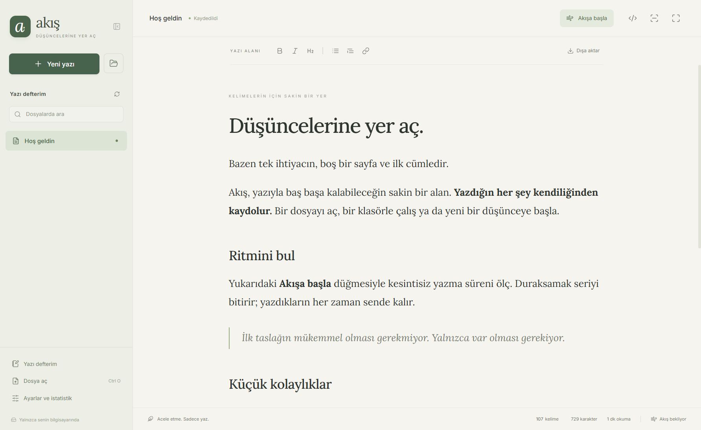

# Akış

Düşüncelerine yer aç. Electron ile çalışan, otomatik kaydeden bir Markdown yazı uygulaması.

## Site ve indirmeler

- [Tanıtım sitesi](https://suatatan.github.io/akis/)
- [İndirme sürümleri](https://github.com/suatatan/akis/releases)
- [Kaynak depo](https://github.com/suatatan/akis)

Tanıtım sitesi docs/ klasöründedir. Yerel fontlar ve gerçek uygulama görüntüleri kullanır. Akış demosundaki metin kaydedilmez veya gönderilmez. İndirme bağlantıları son yayımlanan sürümün gerçek paketlerinden okunur.

GitHub Pages için bu depoda Settings → Pages → Build and deployment → Source → GitHub Actions seçilir. pages.yml yalnızca bu deponun proje sitesini yayınlar. Kişisel hesap sitesinin dosyalarına dokunmaz.

Ana dala uygulama değişikliği gönderildiğinde veya sürüm akışı elle başlatıldığında üç platformun paketleri hazırlanır ve package.json sürümüyle bir GitHub Release yayınlanır. Yeni uygulama sürümü için paket sürümünü artır. Sadece tanıtım sitesi değişiklikleri uygulamayı yeniden paketlemez.

Netlify tercih edilirse aynı docs/ klasörü doğrudan yayımlanabilir; site bir derleme adımı gerektirmez. Yerel doğrulama: npm run test:site.

## Kullanım

Windows kurulum dosyasını veya taşınabilir sürümü aç. Tam ekran başlar; **F11** ile pencereye dönersin.

- **Otomatik kayıt:** Kaydet düğmesine gerek yok. Yazarken kaydeder; belge değiştirirken ve kapanırken bekleyen kaydı tamamlar.
- **Projeler:** Sol panelde iç içe Markdown dosyaları, dosya adında arama ve yenileme. Yeni yazılar açık klasörde oluşturulur.
- **Markdown:** Görsel editör ve ham kaynak görünümü. Başlık, liste, alıntı, kod, bağlantı, tablo, görev listesi ve görsel desteği.
- **Odak ve akış:** Yalnızca yazı alanıyla çalışma, etkin satırı ortada tutma, kesintisiz yazma sayacı. Ayarlanabilen 3–60 saniye mola sınırı ve 1–25 dakika hedef. Yazı hiçbir zaman silinmez.
- **İstatistik:** Belge kelimeleri, karakterler ve okuma süresi; bugün/toplam yazılan kelimeler, son yedi gün, aktif yazma süresi ve en uzun akış.
- **Görünüm:** Kâğıt, adaçayı, kum, gece, özel renk ve yerel arka plan görseli. Lora, Inter, JetBrains Mono, Georgia ve sistem yazı tipi. Boyut, satır aralığı ve genişlik ayarları.
- **Ses:** Sessiz, yumuşak veya daktilo; ayarlanabilen ses düzeyi. Sesler uygulamada üretilir.
- **Dışa aktarma:** Standart UTF-8 Markdown kopyası.

Windows kurulum sürümü .md, .markdown ve .mdown için **Birlikte aç** desteğini ve sağ tık menüsünde **Akis ile yaz** seçeneğini ekler. Windows 11'de klasik menü “Daha fazla seçenek göster” altında olabilir. Taşınabilir sürüm kayıt defterini değiştirmez. Tüm kullanıcılar için kurulum yönetici izni ister.

## Kısayollar

| İşlem | Windows / Linux | macOS |
| --- | --- | --- |
| Yeni yazı | Ctrl N | Cmd N |
| Dosya aç | Ctrl O | Cmd O |
| Proje aç | Ctrl Shift O | Cmd Shift O |
| Odak modu | Ctrl Shift F | Cmd Shift F |
| Markdown kaynağı | Ctrl Shift M | Cmd Shift M |
| Yazıda bul | Ctrl F | Cmd F |
| Kalın / italik | Ctrl B / Ctrl I | Cmd B / Cmd I |
| Geri al | Ctrl Z | Cmd Z |
| Tam ekran | F11 | F11 |

Bağlantıyı tarayıcıda açmak için Ctrl/Cmd ile tıkla. Ctrl/Cmd S bekleyen kaydı tamamlar.

## Veriler ve kurtarma

Hesap, sunucu, telemetri veya zorunlu internet bağlantısı yoktur. Dışarıdan HTTPS görseli içeren bir Markdown belgesi o görseli internetten yükleyebilir.

Veri klasörü Windows'ta %APPDATA%/akis-writer, macOS'ta ~/Library/Application Support/akis-writer, Linux'ta ~/.config/akis-writer altındadır. Kesin konumu **Ayarlar → Dosyalar ve yardım → Yedek ve veri klasörü** ile açabilirsin.

- notes/: Kendiliğinden oluşturulan yazı defteri.
- backups/: Her belgenin bir önceki kaydedilmiş sürümü; dosya adı SHA-256 kimliğidir.
- recovery/: Diskteki dosya dışarıda değiştiğinde korunmuş yeni içerik.
- state.json: Ayarlar ve istatistikler.
- Renderer önbelleği: Oturumlar arası bekleyen içerik kurtarma taslağı.

Başka bir uygulama dosyayı değiştirirse üzerine yazılmaz; durum **Kayıt bekliyor** olur. Yazını dışa aktar. **Diskteki sürümü yeniden aç** da önce bekleyen yazını ayrı dosyaya aktarmanı sağlar, sonra disk sürümünü açar.

Geçici dosya üzerinden atomik kayıt yapılır. Yedekler sürüm geçmişi hizmeti değildir; her belgenin sadece önceki kaydı tutulur. Düzenli harici yedek önerilir.

## İstatistiklerin anlamı

Belge kelime sayımı Unicode harf ve sayılardan oluşan sözcükleri sayar; Türkçe desteklenir. Kaynak görünümünde biçimlendirme işaretleri kısmen ayıklanır.

“Yazılan kelime”, klavye girişinden sonra kelime sayısının pozitif artışlarının toplamıdır. Silip yeniden yazmak yeniden sayılır; yapıştırma, sürükleme ve dosya açma dahil edilmez. Bilimsel üretkenlik ölçümü değildir.

Aktif süre, uygulama odaktayken son yazma girişinden itibaren 5 saniyelik hareketli pencereyi kapsar. Kesintisiz akış ilk ve son tuş arasındaki süredir; sondaki mola sayılmaz. İstatistikler yerel günlere göre tutulur.

## Geliştirme ve paketleme

**Node.js 24 LTS**, npm ve Git gerekir.

~~~sh
npm ci
npx install-electron --no
npm run dev
~~~

~~~sh
npm test
npm run build
npm run test:desktop
npm run dist:win
~~~

Masaüstü testi gerçek Electron penceresi açar, geçici kullanıcı verisiyle çalışır. Ekran görüntüleri test-results/ içine yazılır.

Paketler release/ içinde oluşur. npm run dist:mac ve npm run dist:linux diğer platformları paketler; her paketi kendi sisteminde üretmek önerilir. npm run pack kurulumsuz uygulama klasörü, npm run start derlenmiş uygulamayı açar.

Kod imzalama ayarlanmamıştır: Windows SmartScreen ve macOS Gatekeeper uyarı verebilir. Genel üretim dağıtımı için kendi sertifikanla Windows imzalama ve macOS notarization ekle.

## GitHub'da yayınlama

Bu klasör depo köküdür. node_modules/, dist/, release/ ve test-results/ Git'e eklenmez; package-lock.json eklenmelidir.

~~~sh
git init
git add .
git commit -m "Initial Akis release"
git branch -M main
git remote add origin https://github.com/suatatan/akis.git
git push -u origin main
git tag v0.1.0
git push origin v0.1.0
~~~

GitHub Actions Windows, macOS ve Linux paketlerini hazırlar. v ile başlayan etiket gönderildiğinde paketleri içeren **GitHub Release** oluşturur. Releases üzerinden kontrol et; kullanıcılar oradan indirir. Sonraki sürümde package.json ve kilit dosyasındaki sürümü artırıp yeni etiket kullan. Üç platformlu akış yapılandırılmıştır; ilk GitHub çalışmasında platform sonuçlarını kontrol et.

## Markdown sınırları

Görsel editör standart Markdown biçimlendirmesini normalize edebilir. Frontmatter, dipnot tanımları, özel bloklar ve script/style HTML kaynak görünümünde açılır. Diğer özel uzantılar, matematik ve Mermaid için de kaynak görünümünü kullan. Görsel düzenlemeden önce özgün sürüm yedeklenir.

Proje içindeki göreli PNG/JPEG/WebP/GIF yolları desteklenir; proje dışına çıkan görseller açılmaz. En fazla 8 MB belge ve 10 MB yerel görsel açılır. Görsel editör tüm Typora eklentilerini taklit etmez.

## Mimari ve lisans

Electron ana süreci dosyaları yönetir. Sandbox ve context isolation açıktır; editörün Node erişimi yoktur. Sınırlı ön yükleme köprüsü, kullanıcı tarafından açılan belgeler ve seçilen proje klasörü için dosya işlemleri sağlar. Tiptap ve Vite kullanılır; fontlar gömülüdür.

Başvurular: [Tiptap Markdown](https://tiptap.dev/docs/editor/markdown/getting-started/basic-usage), [Electron Builder NSIS](https://www.electron.build/docs/nsis/), [dosya ilişkilendirme](https://www.electron.build/docs/api/electron-builder.interface.fileassociation/).

MIT. Üçüncü taraf bildirimleri THIRD_PARTY_NOTICES.md ve licenses/ klasöründedir.

